<div align="center">

# 🫀 Hands On

### Hands on the chest. Eyes on the patient. The coach is in your glasses.

**A SPECS Lens that guides a frightened bystander through hands-only CPR and an AED, one step at a time, drawn on the person in front of them.**

Built for **Devpost · Learn AR with SPECS** · Planned with `plan-lens` · Built by Snap's **CLAD** agents through the **Lens Studio MCP** · Verified with **LEAF**


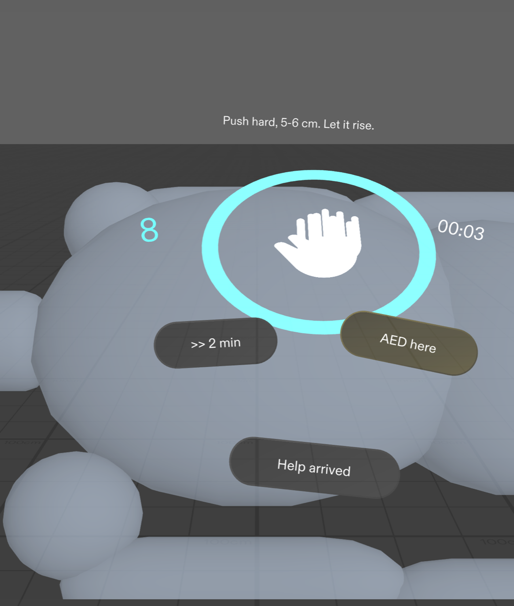


</div>

> ⚠️ **Disclaimer.** Hands On is a training and just-in-time coaching concept based on public hands-only CPR guidance. It is **not a medical device**, it does not detect anything about the patient, and it must not replace professional training or emergency services. In a real emergency, call your local emergency number.

---

## The problem: the first few minutes decide

When someone's heart stops, the person next to them is usually not a medic. It's a parent, a partner or a stranger. Most cardiac arrests outside hospital happen **at home**, and **bystander CPR can double or triple the chance of survival**. Yet people freeze. They push too slowly, lose count, forget to swap when they tire, and don't know where the AED pads go.

**A phone can't help at that moment.** Both hands are on the chest, and your eyes have to stay on the patient.

## The idea: put the coach where the work is

Hands On doesn't float a website in front of your face. It draws the guidance **on the patient**, at real size, and only shows the step you're on.

| What glasses do that a phone can't | How Hands On uses it |
|---|---|
| 👁️ **They share your view** | You're looking at the patient, so the hand target, the beat ring and the pad outlines sit right on their body. |
| 🌍 **They draw in the world** | A two-hands target on the lower breastbone. Pad outlines on the upper right chest and lower left side, at real scale. |
| 🙌 **They leave your body free** | Both hands keep compressing. The beat, the count, the timer and a calm voice guide you without you ever touching a screen. |

---

## See it working

| 1 · Someone collapsed | 2 · Call for help | 3 · Pacer on the chest |
|:---:|:---:|:---:|
| 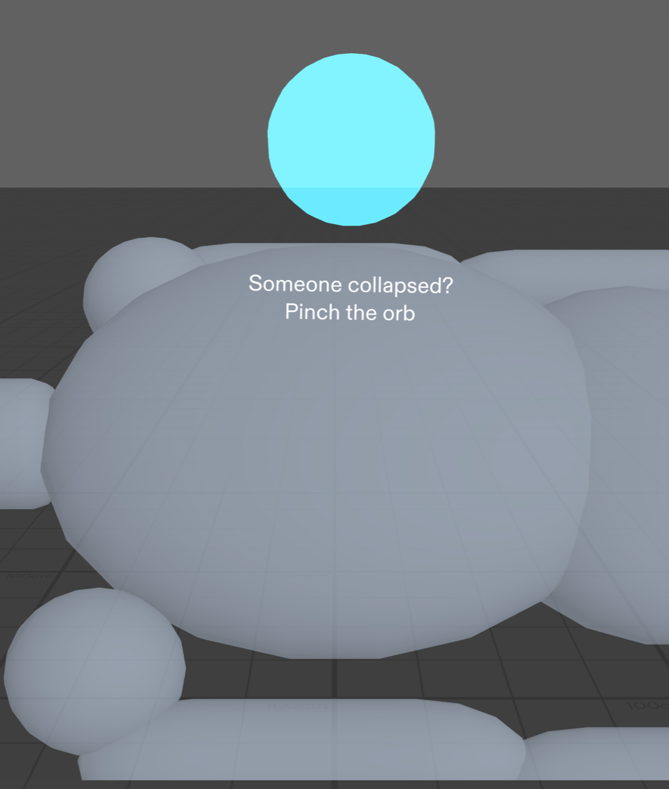 | 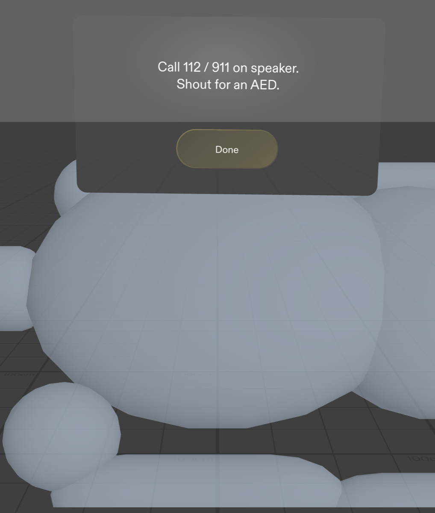 |  |
| One pinch on the orb starts the coach. | "Call 112/911 on speaker. Shout for an AED." | The ring pulses at **110/min** with a click. Counter, timer and push/rise bar sit next to your hands. |

| 4 · Swap rescuers at 2:00 | 5 · AED pads onto the body | 6 · Stand clear, shock |
|:---:|:---:|:---:|
| 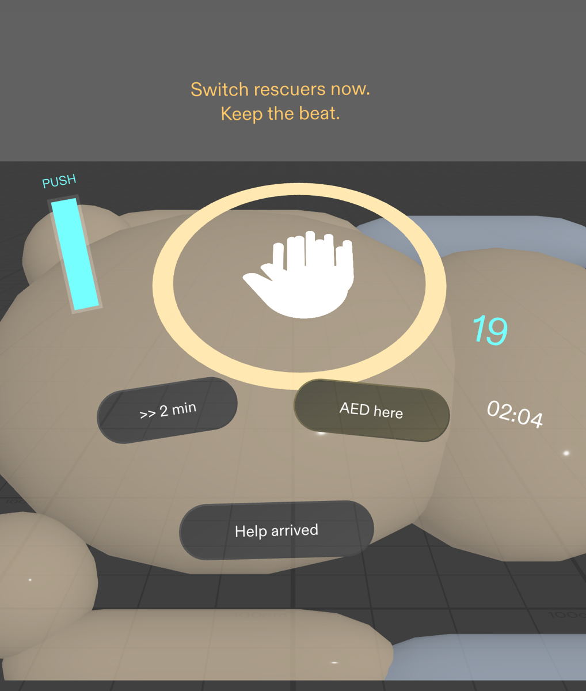 | 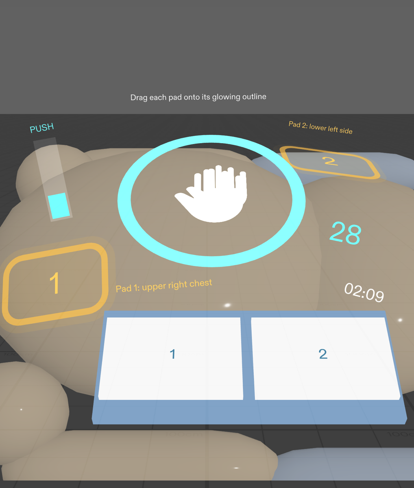 | 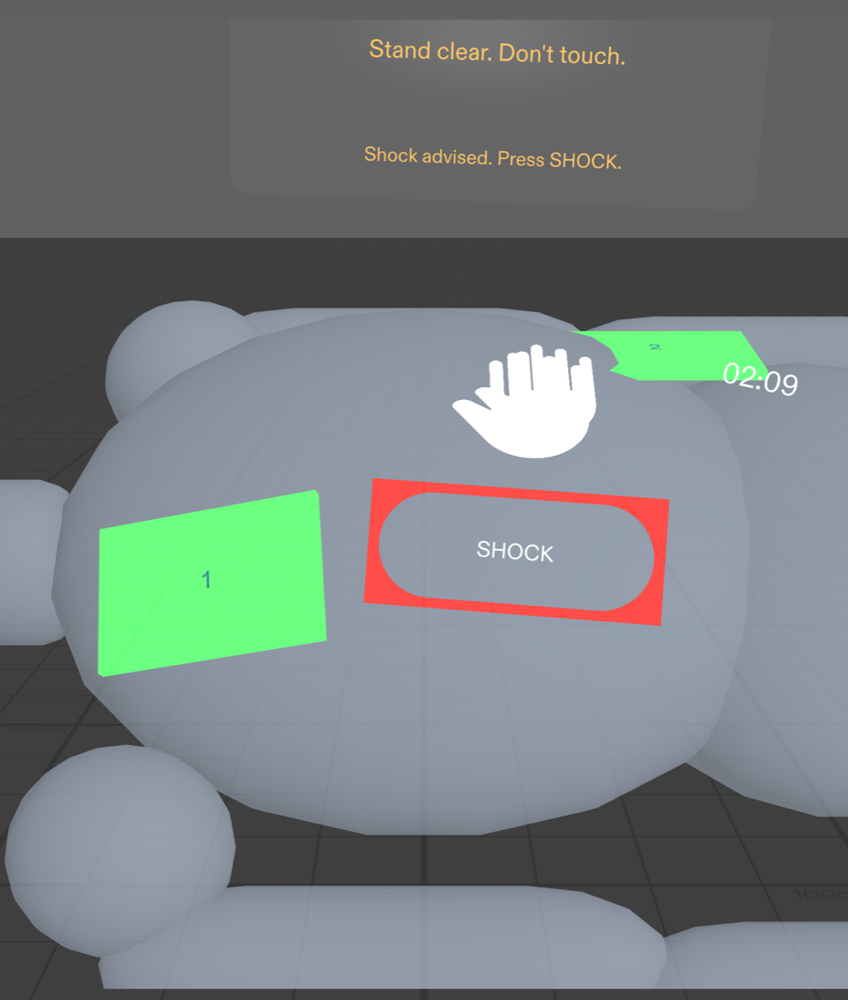 |
| A chime and an amber cue. Compressions weaken after 2 minutes. | Grab each pad and drag it onto its glowing, labelled outline. A wrong drop bounces back with a hint. | The pacer pauses, the AED analyses, then one big **Shock** button. Compressions resume right after. |

| 7 · Handover for the paramedics | 8 · Start again | 9 · Tested with LEAF |
|:---:|:---:|:---:|
| 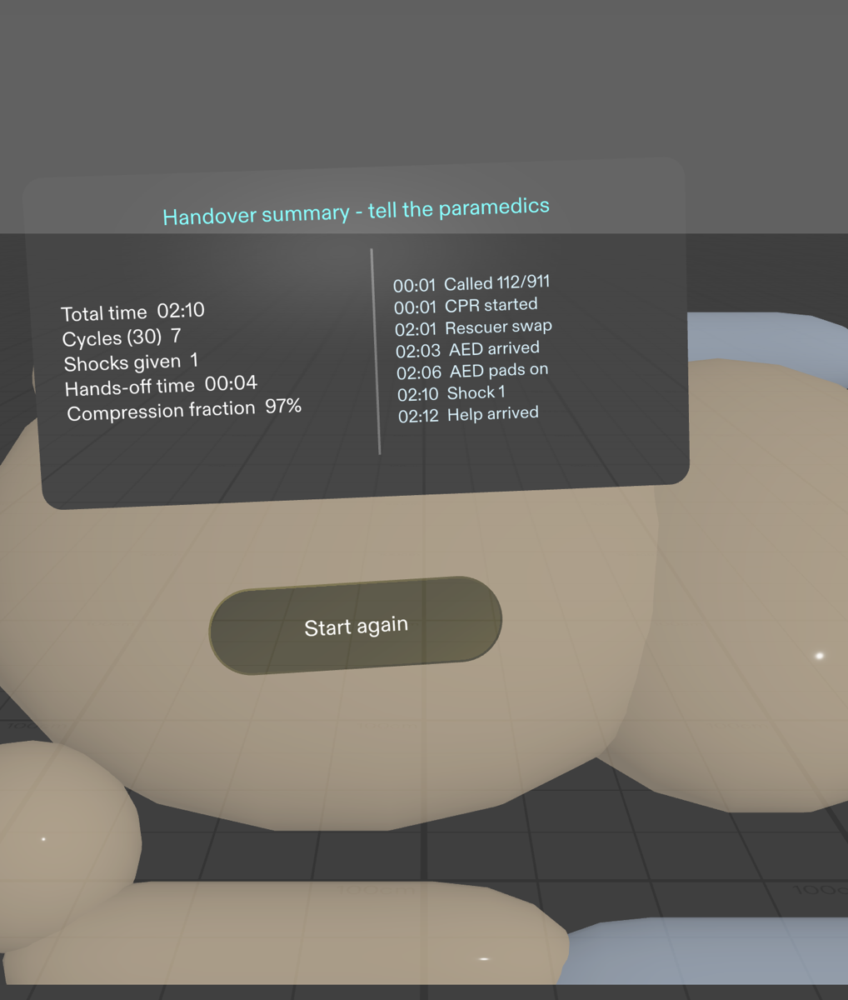 | 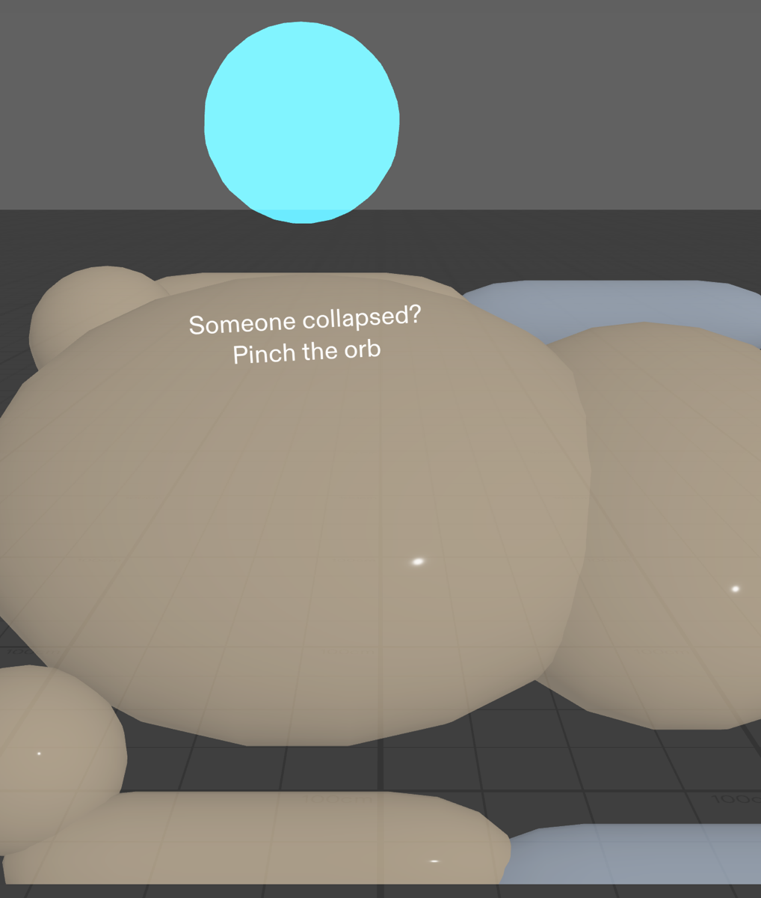 | 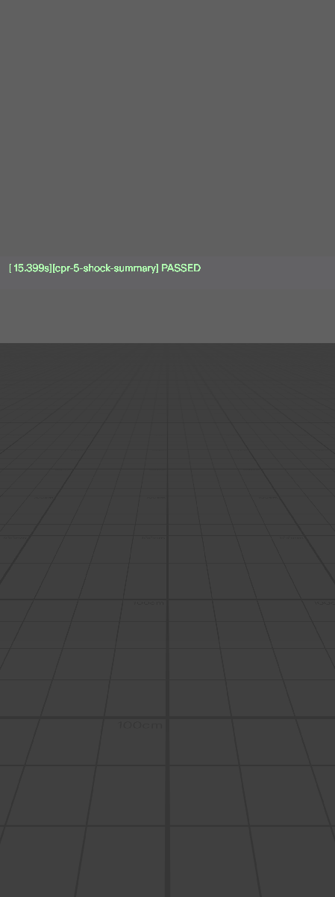 |
| Total time, cycles, shocks, **hands-off time**, **compression fraction** and a timestamped event timeline. | One pinch resets everything for another practice run. | Every done criterion is checked automatically with real SIK pinches and drags. |

---

## The flow

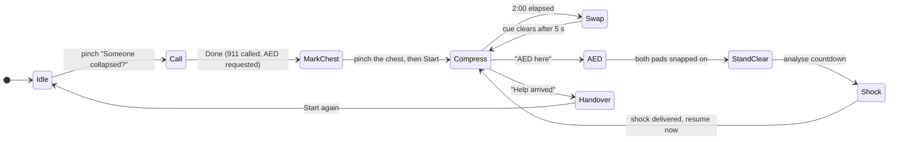

### What you see at each step, and where it lives

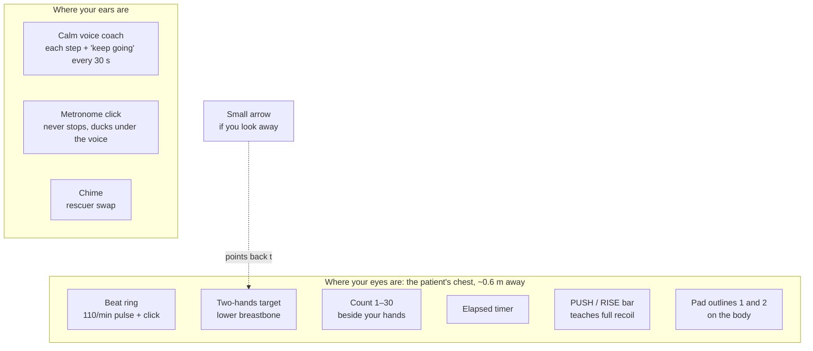

---

## Design decisions

Every decision came out of the `plan-lens` interview and was checked against the AR design rules and the preview's limits. The approved brief is in [`devpost/design-brief.md`](devpost/design-brief.md).

- **A pacer, not a fake sensor.** The preview can't see hand speed or custom gestures, and neither could a judge watching a video. So Hands On never claims to detect compressions. It sets the beat, counts, keeps time and choreographs the AED. All of that is real and visible.
- **One honest stand-in.** On real glasses, body detection would find the chest. In the preview you **pinch the chest once** on a training mannequin, and everything anchors there.
- **Information on the thing it's about.** The ring sits on the breastbone, and the pad outlines sit where the pads go. Nothing hovers at face height.
- **Show it when it's needed.** Only the current step is visible, with at most 3 big buttons. The swap cue appears at 2:00 and clears itself.
- **Audio carries the load.** Your hands are busy and your eyes are on the patient, so a calm voice speaks each step while the 110 bpm click keeps going underneath.
- **Built for an additive display.** Light cyan, white and amber, because black renders as transparent on SPECS. Red is used only for **Shock**.
- **Grab-and-drag as the hero interaction.** Dragging the AED pads uses a standard SIK interaction, so it works with a mouse in the preview, LEAF can test it, and it's the most memorable moment in the video.

---

## How it was built

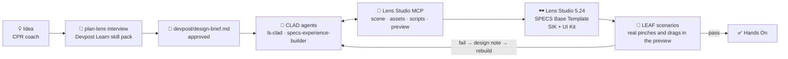

- **Planning:** Devpost Learn's [`plan-lens`](https://learn-specs.devpost.com/resources) skill interviewed me and pushed back where the idea fought the glasses or the preview. It wrote [`devpost/design-brief.md`](devpost/design-brief.md).
- **Building:** Snap's **CLAD** agents (`ls-clad`) built the brief in **Lens Studio 5.24** through the **Lens Studio MCP**, starting from SPECS › Base Template with Spectacles Interaction Kit and UI Kit.
- **Iterating with design notes, not code:** after reviewing preview screenshots, I sent design notes such as "the patient reads as a grey slab, make it a recognisable mannequin" and "move the swap cue next to the ring". CLAD rebuilt and re-tested.
- **Audio:** the click, chime and shock sounds were synthesised with CLAD's `build-sfx`. The voice lines were generated offline with macOS text-to-speech.

### Code map

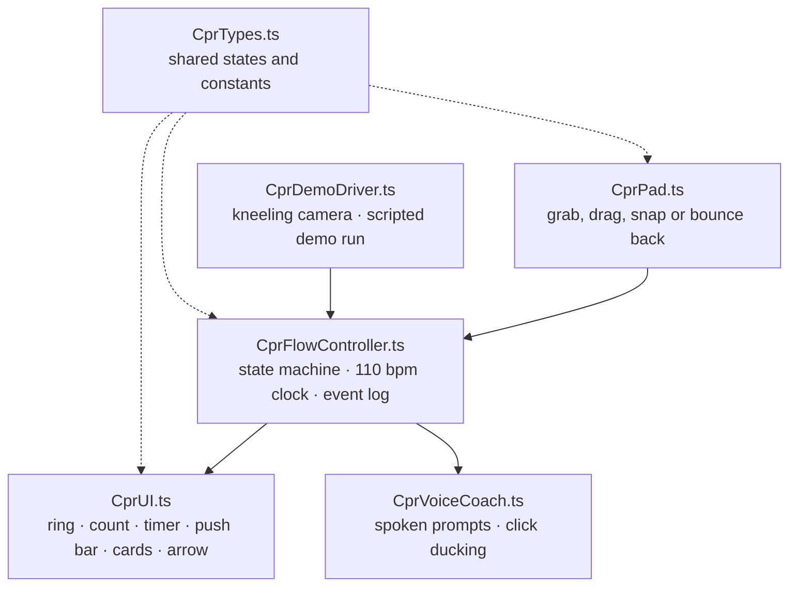

---

## Verified with LEAF

LEAF scenarios in [`Assets/Tests/`](Assets/Tests/) drive the **real SIK interactions** in the Lens Studio preview: actual pinches and pad drags, not shortcuts into the logic.

| # | Done criterion (from the brief) | Scenario | Result |
|---|---|---|---|
| 1 | Pinching the chest places the hand target on the lower breastbone | `CprChestMarkScenario` | ✅ Pass: target within 4.3 cm of the anchor |
| 2 | **Start** makes the ring pulse at 110/min with a click; the counter loops 1–30; the timer runs | `CprPacerScenario` | ✅ Pass: 109.5 bpm measured, counter wraps 30 → 1 |
| 3 | At 2:00 a chime plays and the amber "Switch rescuers" cue shows, then clears | `CprSwapCueScenario` | ✅ Pass |
| 4 | Each AED pad can be dragged; it snaps only onto its correct spot, and a wrong drop returns it | `CprPadsScenario` | ✅ Pass |
| 5 | With both pads on, **Shock** appears after "Stand clear"; pressing it resumes the pacer and counts the shock | `CprShockScenario` | ✅ Pass |

Extra scenarios cover the paramedic handover timeline (`CprHandoverScenario`), restart (`CprRestartScenario`), voice coaching (`CprVoiceScenario`) and the push/rise bar (`CprPushBarScenario`).

**Logic proven:** the flow, timing, pad snapping, shock loop and handover summary.
**Feel unproven** (only real glasses can tell): comfort while moving up and down during compressions, real hand-tracking dropouts, and real body detection in place of the chest pinch.

---

## Who it's for

- **Anyone who isn't a medic:** family members, coworkers, people who did a CPR course years ago and have forgotten the details.
- **Practice:** the same flow works as a drill on a training mannequin. **Start again** resets it for another round.
- **Handover:** paramedics get the facts they ask for (time down, shocks given, hands-off time) without the rescuer having to remember them under stress.

## What I learned

1. **On glasses, the best UI sits on the thing you're touching.** Moving the beat onto the breastbone and the pads onto the body did more than any new feature.
2. **A stand-in is better than a gesture nobody can see.** One pinch to mark the chest is honest, testable and demoable. "Detecting compressions" in the preview would have been a trick.
3. **Every glance has to earn its place.** Cutting to one step at a time, with at most 3 buttons, made the Lens calmer, and calm is the point when someone is panicking.
4. **Design notes beat code edits.** Telling CLAD "the patient reads as a slab" and "move the cue next to the ring" was faster and better than opening the scripts.

---

## Run it

1. Open `HandsOn.esproj` in **Lens Studio 5.24** or later.
2. In the Preview panel, choose **Interactive Preview** with the Spectacles device.
3. The preview starts in a kneeling view over the patient's chest. Clicking acts as a pinch. Move with WASD, use Q and E to go down and up, and right-drag to look around. To start from a standing view instead, untick `kneelCamera` on the `CprDemoDriver` object.
4. To watch a scripted walkthrough, tick `runDemo` on `CprDemoDriver`.
5. To run the tests, open the LEAF panel and run the scenarios with the preview as the target.

## Repo layout

```
Assets/
  Scripts/        CprFlowController, CprUI, CprPad, CprVoiceCoach, CprDemoDriver, CprTypes
  Tests/          LEAF scenarios, one per done criterion, plus extras
  GeneratedSFX/   click, chime, shock and voice lines
  Materials/ Meshes/ Icons/ Render/
devpost/
  design-brief.md the approved plan-lens brief
  screenshots/    preview captures of every step
docs/
  HANDS-ON-playbook.md   idea analysis, interview notes, video script
Packages/         Spectacles Interaction Kit, UI Kit and other Lens Studio packages
```

`Cache/`, `Workspaces/`, `PluginsUserPreferences/` and local MCP configs (such as `.mcp.json`, which holds a local token) are generated or private and are not committed.

---

<div align="center">

**Hands On** · a training and coaching concept for SPECS · not a medical device · if someone collapses, call your local emergency number and start pushing.

</div>
