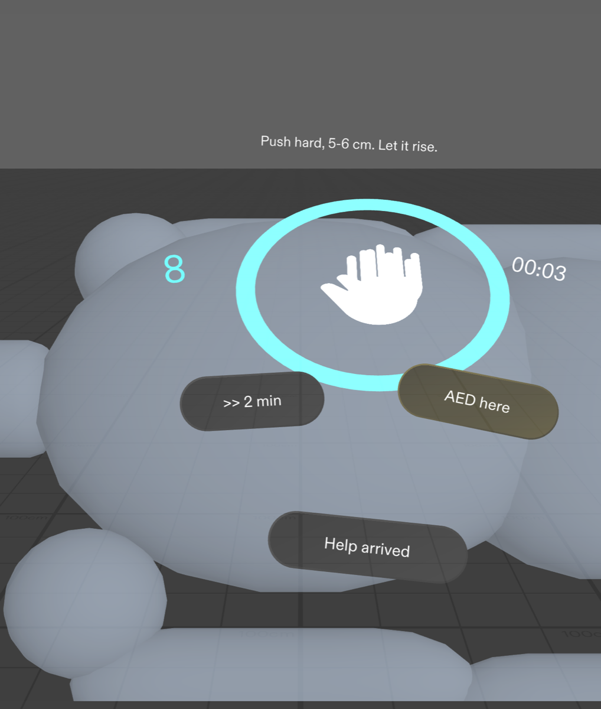
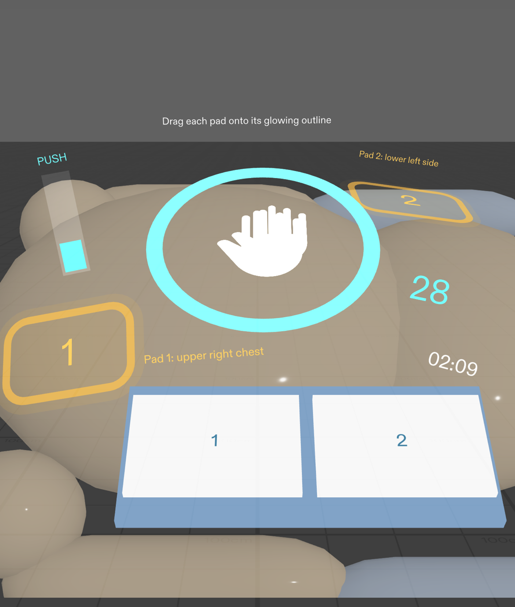
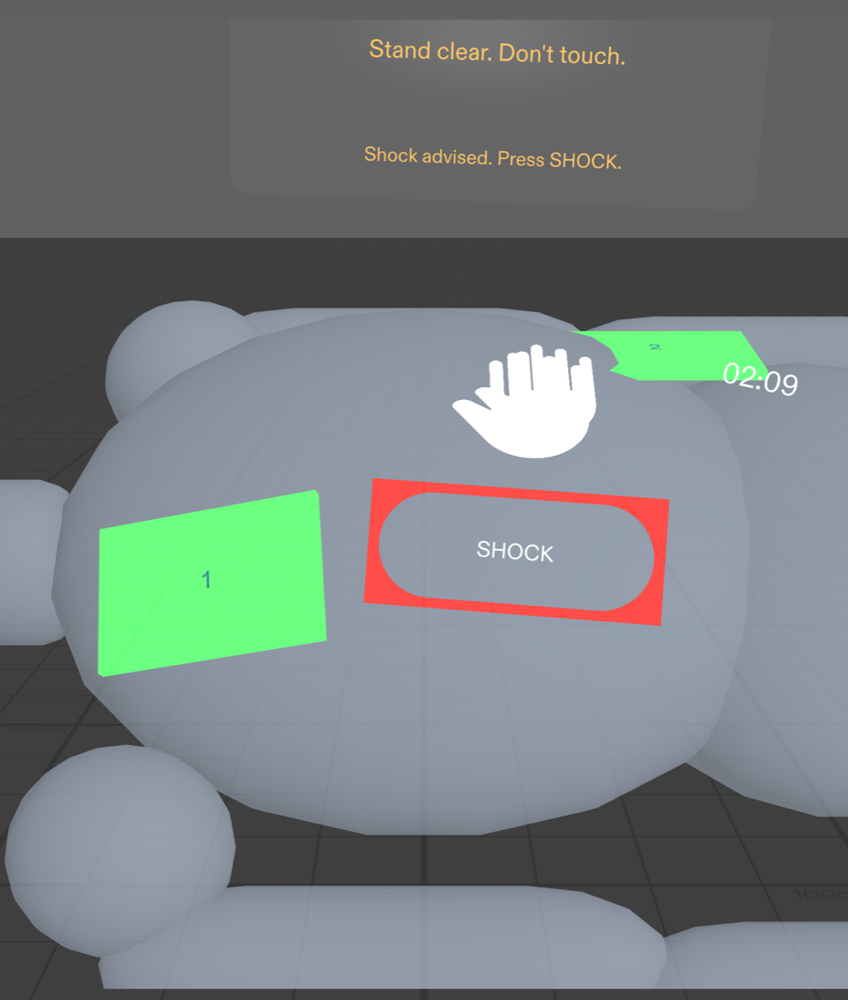
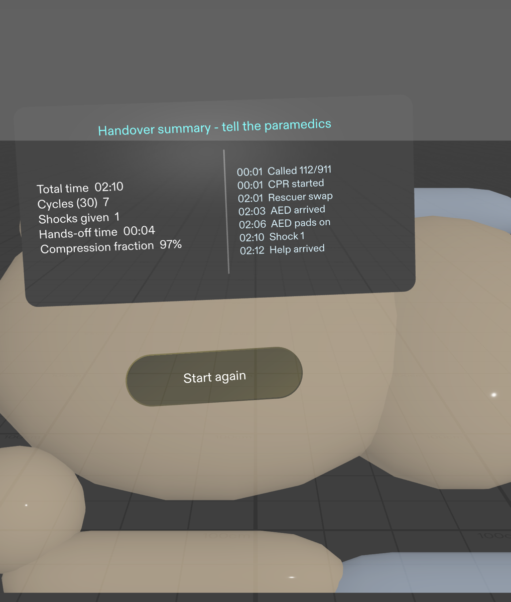

# Hands On — Project Story (Devpost "About the project")

Paste everything below the line into the **About the project** field.
Image links are hotlinked from the public GitHub repo and render inline.

---

## Inspiration

When someone's heart stops, the person next to them is usually not a medic. It's a parent, a partner, a stranger. Most cardiac arrests outside hospital happen **at home**, and bystander CPR can **double or triple** the chance of survival — yet people freeze. They push too slowly, lose count, forget to swap rescuers when they tire, and don't know where the AED pads go.

At that moment, a phone is useless: **both hands are on the chest, and your eyes have to stay on the patient.** But glasses see what you see and leave your hands free. So we asked: what if the coach lived *on the patient*, at real size, one calm step at a time?

That's **Hands On**: a CPR and AED coach for Snap's SPECS glasses, planned with the Devpost Learn skill pack and built entirely by AI coding agents through CLAD in Lens Studio.

## What it does

One pinch on the *"Someone collapsed?"* orb starts the coach:

1. **Call for help** — *"Call 112/911 on speaker. Shout for an AED."* You pinch the chest once to anchor everything to the patient — one honest stand-in for body detection.
2. **The pacer** — a ring pulses at **110/min** right on the breastbone with an audible click. A counter keeps your sets of thirty, a timer runs, and a **PUSH/RISE bar** teaches full recoil (most compressions are too shallow because the chest never rises).
3. **Rescuer swap** — at 2:00 a chime and an amber cue tell you to switch, then clear themselves.
4. **The AED** — drag each pad onto its glowing, labelled outline on the body. Wrong spot? It bounces back with a hint. Both pads on → *"Stand clear"* → analysing → one big **SHOCK** button → compressions resume immediately. Like a real AED, it **re-analyses every 2 minutes** and coaches the next shock.
5. **Handover** — when paramedics arrive, it speaks their language: time down, **first push at**, shocks, **hands-off time**, **longest pause**, **compression fraction**, and a timestamped event timeline.

A calm voice speaks every step while the click ducks underneath, so your hands never leave the chest and your eyes never leave the patient. It **never claims to detect the patient** — it coaches, paces and choreographs.

## How we built it

- **Planned with the Devpost Learn skill pack** — the `plan-lens` skill interviewed us and pushed back where the idea fought the glasses or the preview, producing an approved design brief (`devpost/design-brief.md`) with five testable done criteria.
- **Built by CLAD agents through the Lens Studio MCP** — Snap's `ls-clad` agents constructed the whole Lens in Lens Studio 5.24 (SPECS Base Template, Spectacles Interaction Kit + UI Kit) from the brief, iterating through design notes, not code diffs: *"the patient reads as a grey slab, make it a recognisable mannequin"*, *"move the swap cue next to the ring."*
- **Verified with LEAF** — ten scenarios drive the *real* SIK pinches and pad drags in the preview: chest marking (target within 4.3 cm of the anchor), measured 109.5 bpm pacing, the swap cue, snap-or-bounce pad drops, the shock loop, the 2-minute AED re-analysis loop, the clinical handover metrics, restart cleanliness, voice coaching and the push/rise bar.
- **Audio** synthesised with CLAD's `build-sfx`; voice lines generated offline with macOS text-to-speech; code in TypeScript with a clean split — flow controller, passive view, pad component, voice coach, demo driver.

## Challenges

- **The preview can't see compressions.** Faking detection would have been an invisible trick, so we chose one honest stand-in: pinch the chest once, everything anchors there. Testable, demoable, truthful.
- **An additive display.** Black renders as transparent on SPECS, so the whole palette had to be light and high-contrast — cyan, white, amber — with red reserved exclusively for Shock.
- **A metronome that doesn't drift.** Beats are scheduled on a fixed grid rather than incremented per frame, so 110 bpm stays 110 bpm for the whole run — LEAF measured 109.5.
- **Testing drags, not shortcuts.** The LEAF pad-drag scenarios steer a real SIK `InteractableManipulation` ray with position feedback each frame, so "the pad snaps only on its correct outline" is verified through the actual interaction, not a test hook.

## What we learned

1. **On glasses, the best UI sits on the thing you're touching.** Moving the beat onto the breastbone and the pads onto the body did more than any new feature.
2. **A stand-in is better than a gesture nobody can see.** One pinch to mark the chest is honest; "detecting compressions" in a preview would have been a trick.
3. **Every glance has to earn its place.** One step at a time, at most three buttons — calm is the point when someone is panicking.
4. **Design notes beat code edits.** Telling the agent what to change in design terms was faster and produced better results than editing scripts by hand.

## What's next

On real glasses: body detection to replace the chest pinch, compression-quality feedback from hand tracking, and live emergency-call handoff. Until then, it already works as a training drill on any mannequin — **Start again** resets everything for another round.

> ⚠️ Hands On is a training and just-in-time coaching concept based on public hands-only CPR guidance. It is **not a medical device** and must not replace professional training or emergency services. If someone collapses, call your local emergency number and start pushing.

---

## Field-by-field for step 2

**Built with (tags):** `Lens Studio`, `Snap Spectacles`, `Spectacles Interaction Kit`, `Spectacles UI Kit`, `TypeScript`, `Snap AR`, `LEAF`, `CLAD`, `AI-assisted development`

**Try it out links:**
- `https://github.com/batmandevx/hands-on-specs` (source + full README + LEAF results)

**Project media (image gallery):** upload all 9 files from `devpost/screenshots/` (`01-idle` … `09-restart`). If you only pick a few: `01-idle`, `03-pacer`, `05-aed`, `06-shock`, `07-summary`, `08-leaf`.

**Video demo link:** *record first* — script and timed shot list at `docs/demo-video-script.md` (~2:40, screen recording of the Interactive Preview is perfect). Paste the YouTube URL here once uploaded.
